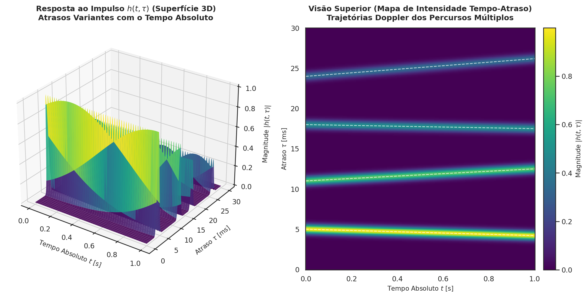

# Inteligência Computacional Aplicada à Extração de Informação de Sinais Multimídia e de Telecomunicações

Repositório da minha **Iniciação Científica**, com modelagem e simulação de **canais de comunicação acústica subaquática (UWA)** e experimentos de **modulação analógica no GNU Radio**.

- **Aluno:** Ricardo Alexandre Vieira da Silva
- **Orientador:** Rafael da Silva Chaves
- **Instituição:** Universidade Federal de Ciência e Inovação
- **Período:** 2026 – atual

---

## Objetivos

- Modelar o canal acústico subaquático como um **canal multipercurso** com atrasos e ganhos aleatórios e efeito Doppler.
- Calcular a **perda de propagação** no meio subaquático em função da frequência e da distância.
- Visualizar a **resposta ao impulso variante no tempo** do canal.
- Praticar **modulação e demodulação AM** (DSB e DSB-SC) no GNU Radio.

---

## 1. Canal acústico subaquático

O canal é modelado como uma soma de L percursos, cada um com ganho h_l e atraso τ_l:

$$h(t) = \sum_{l=0}^{L-1} h_l \, \delta(t - \tau_l)$$

### Modelo estatístico de pequena escala

A função `acoustic_channel` gera a resposta ao impulso discreta do canal com:

- atrasos aleatórios dos percursos;
- ganhos aleatórios em cada percurso;
- efeito Doppler aplicado aos atrasos.

Ela existe em **MATLAB** (`acousticChannel.m`) e **Python** (`acousticChannel.py`). A explicação completa está no [README do programa em MATLAB](acoustic-communications/matlab-program/README.md).

### Modelo de grande escala

O arquivo `underwaterFunctions.py` implementa:

- **Fórmula de Thorp:** atenuação acústica (dB/km) em função da frequência;
- **perda de propagação convencional** e **perda de transmissão** em função da distância.

### Resposta ao impulso variante no tempo

O arquivo `simulate_tv_channel.py` simula um canal com raio direto, reflexão na superfície e reflexão no fundo, cada um com seu próprio fator de Doppler.

---

## 2. Experimentos no GNU Radio

Na pasta [`experiments/AM Modulation`](experiments/AM%20Modulation) estão os fluxogramas (`.grc`) e os scripts Python gerados para:

- modulação **DSB-SC** (portadora suprimida);
- modulação **DSB** com portadora;
- **demodulação** de cada uma delas.

A teoria de AM (índice de modulação, sobremodulação, condição f_c ≫ W) está no [README dos experimentos](experiments/AM%20Modulation/README.md).

---

## 📊 Resultados

### Resposta ao impulso variante no tempo

<p align="center">
  
</p>

À esquerda, a superfície 3D de |h(t, τ)|. À direita, a visão superior (mapa tempo × atraso). Cada faixa é um percurso do sinal (raio direto e reflexões). As faixas ficam **inclinadas** porque o efeito Doppler faz o atraso de cada percurso mudar ao longo do tempo: alguns percursos ficam mais curtos e outros mais longos.

### Perda de propagação em função da frequência

<p align="center">
  
</p>

Perda de propagação de 100 m a 100 km para frequências de 0,1 a 100 kHz, usando a fórmula de Thorp. Em 100 kHz, a perda passa de 100 dB antes de 2 km. Em 0,1 e 1 kHz, ela fica perto de 100 dB mesmo a 100 km. Por isso a comunicação acústica subaquática de longo alcance usa **frequências baixas**, de poucos kHz.

<!--
Sugestão: acrescentar aqui um resultado do GNU Radio, por exemplo um print do
fluxograma DSB-SC e da tela do osciloscópio/espectro mostrando o sinal modulado
e o demodulado.
-->

---

## Estrutura do repositório

```text
Iniciacao-Cientifica/
├── acoustic-communications/
│   ├── matlab-program/          # Canal UWA em MATLAB
│   └── python-program/
│       ├── Acoustic Channel-Taylor/
│       ├── modelo-grande-escala/
│       ├── acousticChannel.py   # Canal UWA em Python
│       └── simulate_tv_channel.py
└── experiments/
    └── AM Modulation/           # Fluxogramas GNU Radio (.grc)
```

---

## Tecnologias

- Python 3: NumPy, SciPy, Matplotlib, Seaborn
- MATLAB
- GNU Radio Companion

## Como executar

```bash
pip install numpy scipy matplotlib seaborn
python acoustic-communications/python-program/simulate_tv_channel.py
```

Para abrir os fluxogramas, use o **GNU Radio Companion** e carregue os arquivos `.grc`.

---

## Referências

1. S. Zhou e Z. Wang, *OFDM for Underwater Acoustic Communications*. Chichester: John Wiley & Sons, 2014.
2. R. S. Chaves, *Modelagem e Simulação de Sistemas de Comunicação Acústica Submarina*, Projeto de Graduação, Universidade Federal do Rio de Janeiro, 2016.
3. X. Lurton, *An Introduction to Underwater Acoustics: Principles and Applications*. Springer, 2004.

